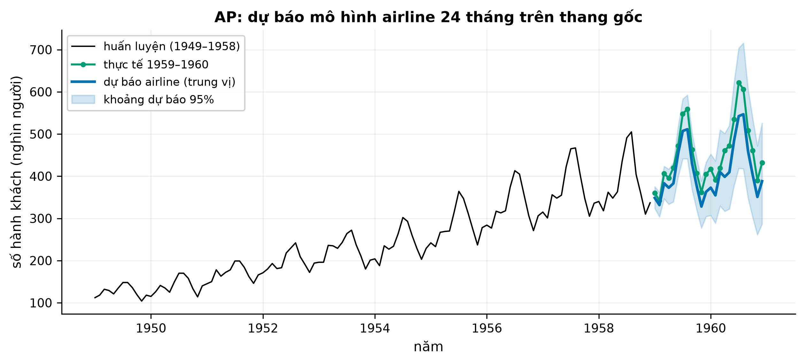
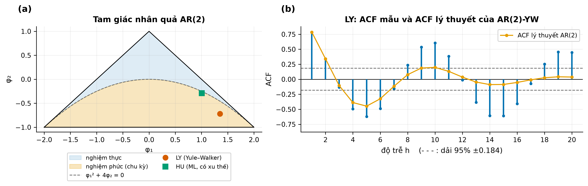
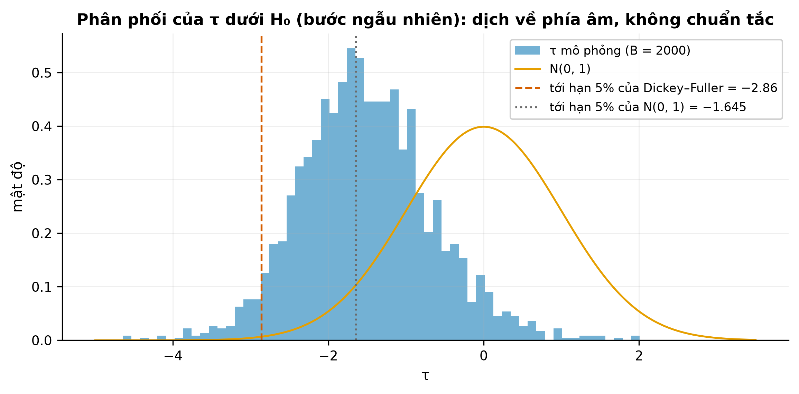
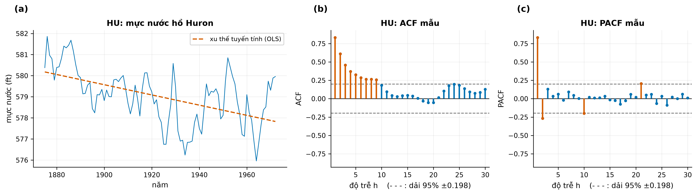
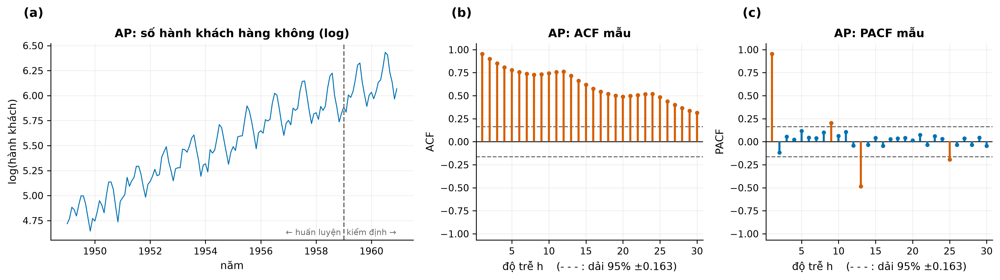
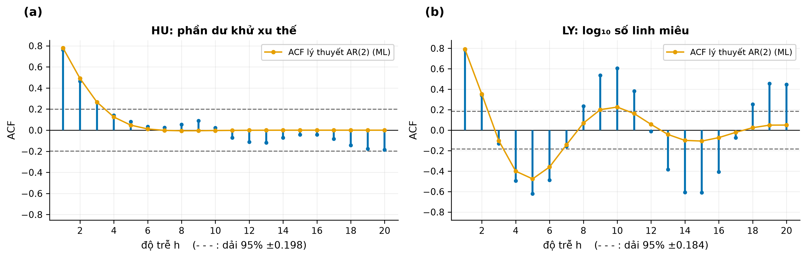
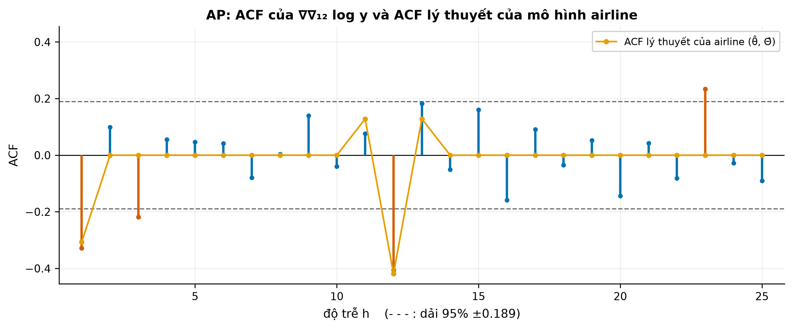
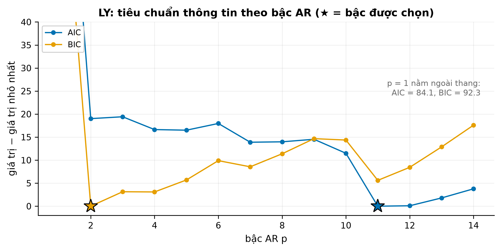
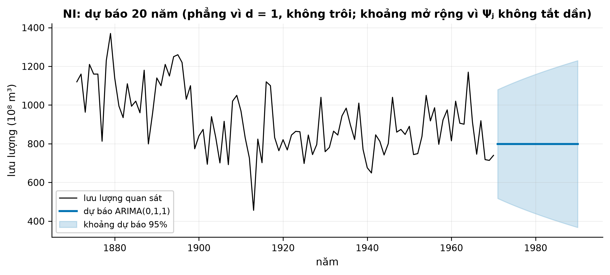

<div align="center">

# Kiểm chứng thực nghiệm các mô hình ARMA và ARIMA trên dữ liệu chuỗi thời gian

**AS3179 – Mô hình thống kê · Bài tập lớn · Bài giảng 11 + 12**
Trường Đại học Bách Khoa – ĐHQG-HCM · Khoa Khoa học Ứng dụng · HK261 · Lớp L01 · Nhóm 7
Giảng viên: TS. Nguyễn Tiến Dũng


-008080?logo=latex&logoColor=white)


[Đọc báo cáo (PDF)](report/BaoCao_AS3179_Nhom7.pdf) ·
[Đặc tả bài tập](docs/spec/dac_ta_bai_tap_lon.md) ·
[Nguồn dữ liệu](data/DATA_SOURCES.md) ·
[Danh mục nội dung kiểm chứng](docs/theory_checklist.md)



<sub>Dự báo 24 tháng của AP bằng mô hình airline SARIMA(0,1,1)(0,1,1)₁₂ trên thang gốc, kèm khoảng dự báo 95%.</sub>

</div>

---

## Mục lục

1. [Giới thiệu](#1-giới-thiệu)
2. [Điểm nhấn](#2-điểm-nhấn)
3. [Dữ liệu](#3-dữ-liệu)
4. [Nội dung kiểm chứng](#4-nội-dung-kiểm-chứng)
5. [Kết quả chính](#5-kết-quả-chính)
6. [Báo cáo LaTeX](#6-báo-cáo-latex)
7. [Cấu trúc dự án](#7-cấu-trúc-dự-án)
8. [Bắt đầu nhanh](#8-bắt-đầu-nhanh)
9. [Tái lập và kiểm thử](#9-tái-lập-và-kiểm-thử)
10. [Biên dịch báo cáo, Overleaf và đóng gói nộp bài](#10-biên-dịch-báo-cáo-overleaf-và-đóng-gói-nộp-bài)
11. [Quy ước](#11-quy-ước)
12. [Thành viên nhóm](#12-thành-viên-nhóm)

---

## 1. Giới thiệu

Lý thuyết chuỗi thời gian cổ điển, gồm ARMA, ARIMA và dự báo, dựa trên những giả thiết gọn như chuỗi dừng, nhiễu có tính chất cho trước và mô hình đúng bậc, trong khi dữ liệu thực hiếm khi thỏa mãn hoàn hảo. Dự án này **lấy từng kết quả lý thuyết trong hai bài giảng, chạy nó bằng Python trên dữ liệu thực, rồi đối chiếu** xem lý thuyết nói gì và dữ liệu cho thấy gì. Ba câu hỏi nghiên cứu:

| | Câu hỏi |
|---|---|
| **CH1** | Các kết quả lý thuyết về cấu trúc phụ thuộc và mô hình ARMA có được thỏa mãn trên dữ liệu thực hay không? |
| **CH2** | Các kết quả lý thuyết về chuỗi không dừng, mô hình ARIMA và dự báo có được thỏa mãn trên dữ liệu thực hay không? |
| **CH3** | Mức độ phù hợp phụ thuộc thế nào vào đặc điểm của từng bộ dữ liệu, và giả thiết nào bị vi phạm? |

Sản phẩm gồm **một báo cáo LaTeX 67 trang**, **bộ mã Python tái lập được toàn bộ kết quả**, 3 notebook, 26 hình và 63 bảng do mã sinh ra, và 177 kiểm thử tự động.

<p align="center">


</p>
<p align="center"><sub>Trái: vị trí của AR(2) khớp trên LY trong tam giác nhân quả. Phải: phân phối của thống kê Dickey–Fuller dưới giả thuyết không, lệch trái so với phân phối chuẩn.</sub></p>

## 2. Điểm nhấn

- **Tự cài đặt rồi đối chiếu.** Tự tương quan mẫu, PACF (đệ quy Durbin–Levinson), Ljung–Box, Yule–Walker, trọng số ψ, ACF lý thuyết, phương sai sai số dự báo, MAE/RMSE/MAPE/MASE, gốc cuốn chiếu và Diebold–Mariano đều được viết tay theo công thức, rồi so với `statsmodels` bằng kiểm thử tự động (sai khác không quá 10⁻⁸).
- **28 nội dung lý thuyết × 6 bộ dữ liệu.** Mỗi nội dung có địa chỉ rõ ràng (ví dụ `2.1.2(c)` được kiểm chứng tại `4.2(c)`), được xếp loại *phù hợp / phù hợp một phần / không phù hợp* theo thang đặt trước.
- **Mô phỏng Monte Carlo có kiểm soát.** Mọi chênh lệch giữa mô phỏng và lý thuyết đều tính theo sai số Monte Carlo (MCSE); dung sai 3 MCSE.
- **Tái lập hoàn toàn.** Một hạt giống duy nhất (`SEED = 3179`), mỗi mô phỏng có dòng số ngẫu nhiên riêng nên thêm hoặc bớt một mô phỏng không đổi kết quả của mô phỏng khác; một lệnh chạy lại từ dữ liệu thô đến bảng và hình.
- **Báo cáo trình bày chỉn chu.** Mục lục, danh mục ký hiệu và chữ viết tắt, mọi tham chiếu chương, mục, bảng, hình và tài liệu đều bấm được, hình và bảng tự chèn từ đầu ra của mã.

## 3. Dữ liệu

Sáu bộ dữ liệu lấy từ kho [Rdatasets](https://vincentarelbundock.github.io/Rdatasets/) (bản sao các bộ dữ liệu của gói `datasets` trong R). Sau khi tải, dữ liệu thô được kiểm tra tự động (số quan sát, giá trị thiếu, dòng trùng, thứ tự thời gian) rồi biến đổi; chi tiết ở [`data/DATA_SOURCES.md`](data/DATA_SOURCES.md).

| Ký hiệu | Bộ dữ liệu | Quan sát | n | Thời gian | Biến được mô hình hóa | Dùng cho |
|:-:|---|---|--:|---|---|---|
| **HU** | Mực nước hồ Huron | hằng năm | 98 | 1875–1972 | mực nước (ft), kèm biến xu thế | Bài 11 |
| **LY** | Linh miêu bị bẫy ở Canada | hằng năm | 114 | 1821–1934 | log₁₀ số linh miêu | Bài 11 |
| **DR** | DAX, suất sinh lợi | ngày giao dịch | 1859 | 1991–1998 | suất sinh lợi log (%) | Bài 11 |
| **NI** | Lưu lượng sông Nile | hằng năm | 100 | 1871–1970 | lưu lượng (10⁸ m³) | Bài 12 |
| **AP** | Hành khách hàng không (AirPassengers) | hằng tháng | 144 | 1949–1960 | log số hành khách; huấn luyện 120, kiểm định 24 | Bài 12 |
| **DP** | DAX, log giá | ngày giao dịch | 1860 | 1991–1998 | log giá đóng cửa; huấn luyện 1500, kiểm định 360 | Bài 12 |

<p align="center">


</p>
<p align="center"><sub>Khám phá dữ liệu: HU có xu thế giảm, AP có xu thế tăng cùng mùa vụ rõ; ACF và PACF mẫu ở bên phải.</sub></p>

## 4. Nội dung kiểm chứng

Hai bài giảng được chia thành 3 mục, mỗi mục kiểm chứng ở một chương riêng; mỗi nội dung trong chương có **sáu phần cố định** theo đặc tả (lý thuyết cần kiểm chứng, cách triển khai, mã Python, kết quả tính toán, phân tích và diễn giải, nhận xét).

| Chương | Mục lý thuyết | Nội dung | Số nội dung | Bộ dữ liệu |
|:-:|---|---|:-:|---|
| **4** | 2.1 Chuỗi dừng và mô hình ARMA | tính dừng, tự hiệp phương sai, quá trình tuyến tính; AR(1), AR(p) và Yule–Walker, AR(2), MA(q), ARMA(p, q); ACF và Ljung–Box, PACF, ước lượng, chọn bậc, chẩn đoán phần dư | 14 | HU, LY, DR |
| **5** | 2.2 Chuỗi không dừng và mô hình ARIMA | xu thế tất định và ngẫu nhiên, bước ngẫu nhiên (kèm đồng tích hợp); ARIMA và độ trôi, ARIMA mùa vụ (airline); sai phân quá mức, kiểm định nghiệm đơn vị ADF và KPSS | 7 | NI, AP, DP |
| **6** | 2.3 Dự báo và đánh giá dự báo | ảnh hưởng vĩnh viễn của cú sốc, làm trơn mũ; khoảng dự báo, thang logarit; mốc chuẩn và thước đo sai số, gốc cuốn chiếu, Diebold–Mariano, quy trình báo cáo dự báo | 7 | NI, AP, DP |

Danh mục đầy đủ 28 nội dung, kèm cách kiểm chứng, kiểu (dữ liệu thực hoặc mô phỏng) và vị trí trong notebook, nằm ở [`docs/theory_checklist.md`](docs/theory_checklist.md).

## 5. Kết quả chính

**Mức độ phù hợp:** trong 61 cặp (nội dung, bộ dữ liệu), **55 cặp phù hợp, 6 cặp phù hợp một phần, 0 cặp không phù hợp**; theo nội dung là 24 trên 28 nội dung phù hợp. Các kết quả mang tính công thức khớp đến độ chính xác máy; những chỗ chưa khớp đều nằm ở kết quả phụ thuộc dữ liệu hoặc cỡ mẫu.

| Chương | Mục lý thuyết | Nội dung phù hợp | Cặp (nội dung, bộ dữ liệu) phù hợp / phù hợp một phần |
|:-:|---|:-:|:-:|
| 4 | 2.1 Chuỗi dừng và ARMA | 12 / 14 | 28 / 2 |
| 5 | 2.2 Chuỗi không dừng và ARIMA | 4 / 6 | 8 / 4 |
| 6 | 2.3 Dự báo và đánh giá dự báo | 8 / 8 | 19 / 0 |
| | **Tổng** | **24 / 28** | **55 / 6** |

Bảng xếp loại chi tiết từng cặp nằm ở Bảng 7.1 của báo cáo.

### Một số phát hiện

| Chủ đề | Kết quả |
|---|---|
| **Trung bình mẫu khi có phụ thuộc** (HU) | khoảng tin cậy "ngây thơ" chỉ phủ **64.7%** thay vì 95%, khoảng hiệu chỉnh phủ **94.4%**; $\hat\tau = 3.09$ nên cỡ mẫu hiệu dụng chỉ khoảng 32 thay vì 98 |
| **Chu kỳ của LY** | AR(2) với nghiệm phức cho chu kỳ **9.66 năm**, khớp ACF mẫu; AIC chọn bậc 11, BIC chọn bậc 2; AR(2) chưa đủ vì phần dư còn tự tương quan, AR(11) thì đạt |
| **Cụm biến động** (DR) | suất sinh lợi là nhiễu trắng (Ljung–Box $p=0.78$) nhưng **không iid**: bình phương của nó tự tương quan rất mạnh ($p<10^{-4}$) |
| **Hồi quy giả mạo** (DP) | hai bước ngẫu nhiên độc lập bị bác bỏ $\beta_1=0$ tới **76.9%** số lần thay vì 5% |
| **Nghiệm đơn vị** | phân phối Dickey–Fuller lệch khỏi phân phối chuẩn: dùng giá trị tới hạn $-1.645$ thì bác bỏ sai tới 45.7%; NI cho khuôn mẫu "cùng bác bỏ" của ADF và KPSS do đổi mức quanh năm 1899 |
| **Dự báo AP** | mô hình airline có RMSE **43.2** so với 77.0 của naive mùa vụ; kiểm định Diebold–Mariano bác bỏ mạnh ($DM=-7.49$) |
| **Dự báo NI và DP** | ARIMA không hơn naive hay trôi một cách có ý nghĩa; ở NI trung bình mở rộng còn thắng ARIMA từ chân trời $h=2$ |

<p align="center">


</p>
<p align="center"><sub>Trái: ACF mẫu (que) và ACF lý thuyết của AR(2) (đường) cho HU và LY. Phải: ACF của ∇∇₁₂ log AP và ACF lý thuyết của mô hình airline, khớp cấu trúc bốn độ trễ 1, 11, 12, 13.</sub></p>

<p align="center">


</p>
<p align="center"><sub>Trái: AIC và BIC của LY theo bậc AR (AIC chọn 11, BIC chọn 2). Phải: dự báo ARIMA(0,1,1) của NI cùng khoảng dự báo 95% loe dần vì $d=1$.</sub></p>

### Ví dụ bảng kết quả

Các bảng do mã sinh ra ở ba dạng (`.csv` đủ chữ số, `.md`, `.tex` sẵn caption và nhãn) trong [`outputs/tables/`](outputs/tables/). Hai ví dụ:

**Yule–Walker giải tay so với thư viện** (`tab_b11_07_yule_walker`)

| bộ | p | φ̂₁ | φ̂₂ | σ̂² (tay) | Max\|φ̂ tay − thư viện\| | Min \|z\| | Nhân quả |
|---|---|---|---|---|---|---|---|
| LY | 2 | 1.35 | -0.72 | 0.0571 | 4.4e-16 | 1.178 | Có |
| LY | 11 | 1.139 | -0.508 | 0.0427 | 1.0e-14 | 1.016 | Có |
| HU | 2 | 0.9714 | -0.2754 | 0.4857 | 1.7e-16 | 1.905 | Có |

**AP: độ chính xác dự báo trên tập kiểm định 24 tháng** (`tab_b12_11_ap_benchmarks`)

| Phương pháp | RMSE | MAE | MAPE (%) | MASE |
|---|--:|--:|--:|--:|
| **airline** | **43.18** | **39.44** | **8.515** | **1.38** |
| naive mùa vụ | 76.99 | 71.25 | 15.52 | 2.494 |
| trôi | 115.7 | 91.62 | 18.41 | 3.206 |
| naive | 137.3 | 115.2 | 23.58 | 4.033 |
| trung bình | 219.4 | 206.3 | 44.23 | 7.221 |

## 6. Báo cáo LaTeX

Báo cáo nằm ở [`report/`](report/); bản PDF hoàn chỉnh là [`report/BaoCao_AS3179_Nhom7.pdf`](report/BaoCao_AS3179_Nhom7.pdf).

| Phần | Tệp | Nội dung |
|---|---|---|
| Bìa, đầu trang | [`main.tex`](report/main.tex) | khung trang, macro liên kết, định dạng tiêu đề, bìa |
| Phần đầu | [`front/`](report/front/) | `01_loi_cam_on`, `02_loi_noi_dau`, `03_danh_muc_ky_hieu` |
| Các chương | [`chapters/`](report/chapters/) | `01_gioi_thieu` · `02_co_so_ly_thuyet` · `03_du_lieu_phuong_phap` · `04`–`06_kiem_chung_*` · `07_thao_luan` · `08_ket_luan` |
| Phần cuối | [`back/`](report/back/) | `01_tai_lieu_tham_khao` (kèm nguồn dữ liệu DL1–DL6), `02_phu_luc` (phân công; mã nguồn và tái lập) |
| Tài nguyên | [`assets/`](report/assets/) | logo và nền bìa |

Hình và bảng không chép tay mà được chèn tự động từ [`outputs/`](outputs/); mọi tham chiếu chéo (`\chg`, `\muc`, `\ndlk`, `\tlk`, `\dlk`) đều là liên kết bấm được.

## 7. Cấu trúc dự án

```text
.
├── README.md
├── pyproject.toml            # gói nội bộ as3179ts (cài editable)
├── requirements.txt          # phụ thuộc trực tiếp
├── requirements-lock.txt     # phiên bản đã dùng để tái lập
├── run_all.py                # một lệnh chạy toàn bộ quy trình
│
├── data/
│   ├── raw/                  # 5 CSV gốc từ Rdatasets + checksums.txt (không sửa tay)
│   ├── processed/            # 6 tệp đã làm sạch, mỗi bộ dữ liệu một tệp
│   └── DATA_SOURCES.md       # nguồn, codebook, các bước làm sạch
│
├── src/as3179ts/             # thư viện dùng chung
│   ├── config.py             # SEED = 3179, đường dẫn, hằng số chia dữ liệu
│   ├── data.py               # nạp và kiểm tra dữ liệu
│   ├── acf_tools.py          # ACF, PACF (Durbin–Levinson), Ljung–Box, dải Bartlett
│   ├── arma_tools.py         # Yule–Walker, nghiệm nhân quả/khả nghịch, trọng số ψ, ACF lý thuyết
│   ├── forecast_tools.py     # trọng số Ψ, phương sai sai số dự báo, làm trơn mũ, mốc chuẩn
│   ├── evaluation.py         # MAE/RMSE/MAPE/MASE, gốc cuốn chiếu, Diebold–Mariano
│   ├── simulation.py         # mô phỏng AR/MA/ARMA/bước ngẫu nhiên, child_rng
│   ├── plotting.py           # style hình thống nhất, lưu PNG 300 dpi
│   ├── reporting.py          # xuất bảng .csv/.md/.tex (booktabs)
│   └── captions.py           # chú thích của từng hình và bảng
│
├── notebooks/                # nơi sinh kết quả
│   ├── 00_kham_pha_du_lieu.ipynb      # khám phá dữ liệu (mục 3.2)
│   ├── bai11_arma.ipynb               # 11.1–11.14 → Chương 4
│   └── bai12_arima_du_bao.ipynb       # 12.1–12.14 (+ mở rộng) → Chương 5, 6
│
├── scripts/                  # các bước chạy từng phần
│   ├── 01_download_data.py            # tải dữ liệu (cần mạng)
│   ├── 02_preprocess.py               # làm sạch và biến đổi
│   ├── 03_extract_lecture_text.py     # trích text từ PDF bài giảng
│   ├── 04_build_report.py             # biên dịch báo cáo ra PDF
│   ├── 05_package_submission.py       # đóng gói bài nộp LMS
│   └── 06_make_overleaf_zip.py        # đóng gói để upload Overleaf
│
├── tests/                    # 177 kiểm thử (dữ liệu, hàm tay vs statsmodels, số liệu bài giảng, bảng)
│
├── outputs/                  # đầu ra do mã sinh ra (không sửa tay)
│   ├── figures/              # 26 hình PNG 300 dpi
│   └── tables/               # 63 bảng × 3 dạng (.csv, .md, .tex)
│
├── report/                   # báo cáo LaTeX (xem mục 6)
│   ├── main.tex   front/   chapters/   back/   assets/
│   └── BaoCao_AS3179_Nhom7.pdf
│
├── docs/
│   ├── spec/dac_ta_bai_tap_lon.md     # đặc tả nguyên văn
│   ├── lectures/  lectures_text/      # 2 PDF bài giảng và text trích ra
│   ├── theory_checklist.md            # 28 nội dung kiểm chứng
│   └── reference_values.md            # số liệu tham chiếu của bài giảng
│
└── dist/                     # (bị bỏ qua bởi git) gói Overleaf; submission/ là gói nộp bài
```

## 8. Bắt đầu nhanh

Cần Python 3.11 hoặc 3.12. Các lệnh dưới đây chạy trong PowerShell (Windows), từ thư mục gốc của dự án.

```powershell
py -3.12 -m venv .venv
.\.venv\Scripts\python.exe -m pip install -r requirements.txt -e .
.\.venv\Scripts\python.exe -m ipykernel install --user --name as3179-ts --display-name "AS3179 time series"

.\.venv\Scripts\python.exe run_all.py                 # tải dữ liệu → làm sạch → kiểm thử → chạy 3 notebook
.\.venv\Scripts\python.exe run_all.py --with-report   # thêm bước biên dịch báo cáo PDF (cần LaTeX)
```

Gói nội bộ `as3179ts` được cài ở chế độ editable (`-e .`). Nếu PowerShell chặn `Activate.ps1`, hãy gọi thẳng `.\.venv\Scripts\python.exe` mà không cần đổi ExecutionPolicy. Chỉ `scripts/01_download_data.py` dùng mạng và sẽ bỏ qua nếu `data/raw/` đã có (thêm `--force` để tải lại). Bước chạy notebook mất vài phút vì có nhiều mô phỏng và khớp lại mô hình.

## 9. Tái lập và kiểm thử

- **Hạt giống duy nhất** `SEED = 3179` ở [`src/as3179ts/config.py`](src/as3179ts/config.py). Mỗi mô phỏng nhận một dòng số ngẫu nhiên riêng qua `simulation.child_rng(bài, mục, …)`, nên kết quả không phụ thuộc thứ tự chạy các ô và việc thêm hoặc bớt một mô phỏng không làm đổi kết quả của mô phỏng khác.
- **Phiên bản phần mềm** đã dùng: Python 3.12.14, statsmodels 0.15.0, numpy 2.5.5, pandas 3.1.1, scipy 1.18.1, matplotlib 3.11.2, pytest 9.2.0 (đầy đủ ở [`requirements-lock.txt`](requirements-lock.txt)).
- **Kiểm thử:** `python -m pytest -q` cho **177 đạt và 9 xfail**. Các nhóm kiểm thử: `test_data` (số quan sát, giá trị thiếu, thứ tự thời gian), `test_manual_vs_library` (hàm tự cài đặt khớp statsmodels, sai khác không quá 10⁻⁸), `test_lecture_reference` (tái lập các con số của bài giảng) và `test_reporting` (sinh bảng).
- **9 xfail** là các phép đối chiếu với số liệu in trong bài giảng khác chút ít do cách làm tròn, tối ưu số hoặc dòng số ngẫu nhiên; từng trường hợp có ghi lý do trong mã kiểm thử. Bảng so sánh nằm ở [`outputs/tables/lecture_reference_check.md`](outputs/tables/lecture_reference_check.md).

## 10. Biên dịch báo cáo, Overleaf và đóng gói nộp bài

**Biên dịch báo cáo**

- *VS Code (khuyến nghị):* cài MiKTeX (`winget install MiKTeX.MiKTeX --scope user`) và extension *LaTeX Workshop* (đã gợi ý trong `.vscode/extensions.json`); mở `report/main.tex` rồi lưu (Ctrl+S) là tự biên dịch bằng pdfLaTeX hai lượt vào `report/build/`.
- *Dòng lệnh:* `python scripts\04_build_report.py`, kết quả là `report/BaoCao_AS3179_Nhom7.pdf`.

**Overleaf**

```powershell
.\.venv\Scripts\python.exe scripts\06_make_overleaf_zip.py   # tạo dist/AS3179_Nhom7_Overleaf.zip
```

Upload tệp zip lên Overleaf (*New Project → Upload Project*), chọn compiler **pdfLaTeX** và main document **main.tex**. Gói chỉ chứa những hình và bảng mà báo cáo thực sự gọi, và đã được kiểm tra biên dịch được từ đầu.

**Nộp bài LMS**

```powershell
.\.venv\Scripts\python.exe scripts\04_build_report.py
.\.venv\Scripts\python.exe scripts\05_package_submission.py   # tạo submission/
```

`submission/` gồm `.tex`, `.pdf`, mã nguồn (`.py`, `.ipynb`), dữ liệu gốc và đã làm sạch (không nén), và **chỉ** `figures.zip` cho hình rời, đúng yêu cầu của đặc tả. Hạn nộp bản mềm: **12:00 thứ Hai, 30/11/2026**; bản in nộp trong 5 phút đầu buổi học (không dùng bìa nhựa, không dán băng keo).

## 11. Quy ước

- **Ký hiệu bộ dữ liệu:** HU, LY, DR, NI, AP, DP, giải thích trong *Danh mục ký hiệu và chữ viết tắt* của báo cáo; chữ viết tắt mới được thêm vào đó.
- **Địa chỉ nội dung:** kết quả `2.m.n(z)` ở Chương 2 được kiểm chứng tại `(m+3).n(z)`.
- **DAX không có ngày lịch:** chỉ có chỉ số ngày giao dịch `t = 1..1860`.
- **Hàm tự cài đặt** (`acf_tools`, `arma_tools`, `forecast_tools`, `evaluation`) không gọi statsmodels; thư viện này chỉ dùng để đối chiếu.
- **Tệp văn bản UTF-8**; tên tệp không dấu, không khoảng trắng; ảnh trong `report/assets/` luôn gọi bằng đường dẫn `assets/…`.
- **Tên hình và bảng:** `fig_b<bài>_<mục>_<nội dung>` và `tab_b<bài>_<mục>_<nội dung>`; chú thích của chúng nằm ở `src/as3179ts/captions.py`.

## 12. Thành viên nhóm

**Nhóm 7 – Lớp L01 – HK261**

| STT | Họ và tên | MSSV |
|:-:|---|:-:|
| 1 | Lý Anh Quân | 2412896 |
| 2 | Vũ Trần Hoàng Quân | 2412928 |
| 3 | Hồ Lê Ngọc Quang | 2412819 |
| 4 | Phạm Nhật Quang | 2412846 |
| 5 | Phạm Anh Quốc | 2412939 |

Phân công chi tiết xem Phụ lục A của báo cáo.
